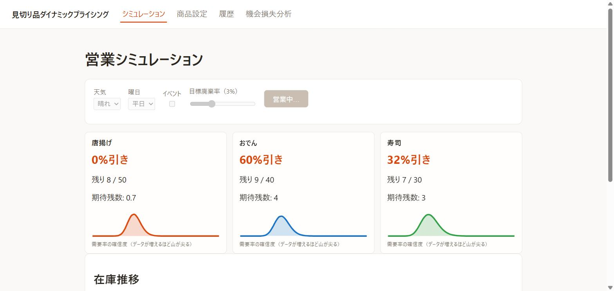
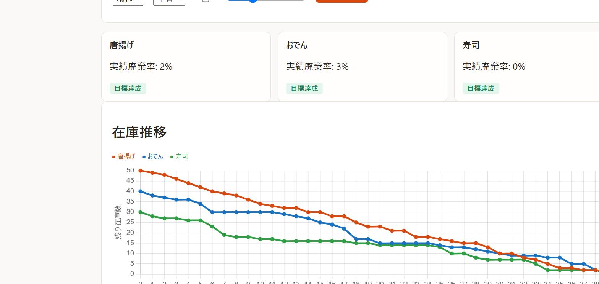
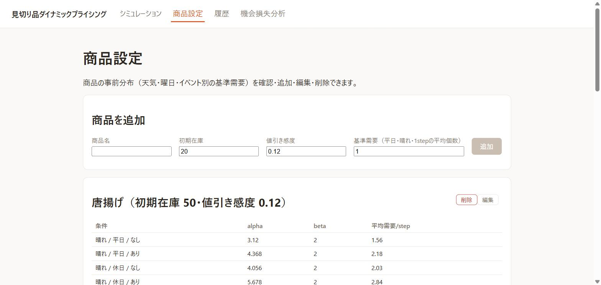
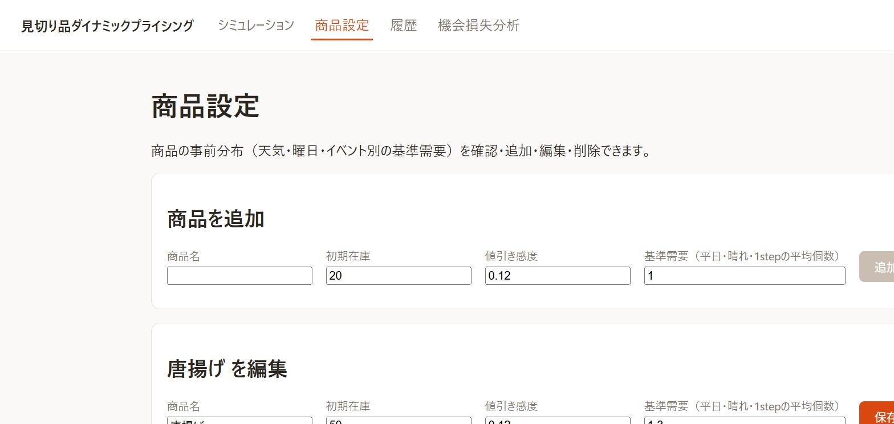
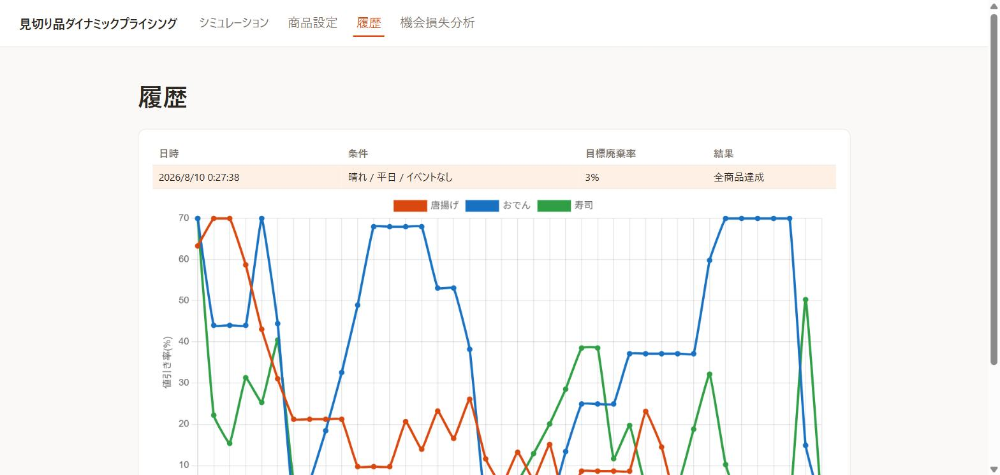
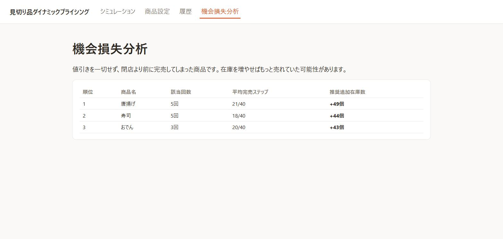

# 見切り品ダイナミックプライシング・シミュレーター

スーパーの惣菜部門でのアルバイト経験から着想したポートフォリオ用アプリです。
値引きのタイミングが「19時＝3割引・20時半＝半額」のように固定化されていて、
雨の日は売れ残り（廃棄ロス）、晴れの日は早期完売（機会損失）が起きているのを見て、
「その日の売れ行きに応じて値引き幅をリアルタイムに最適化できないか」という発想から作りました。

天気・曜日・イベントの有無ごとに過去の売れ行き（事前分布）を持たせておき、営業中に発生する
購入ログをベイズ更新の材料（尤度）として使い、目標廃棄率を満たす値引き率を逐次計算します。
実店舗とは連携せず、乱数によるシミュレーションとして動作を確認できるデモです。

## この意思決定モデルについて

大学の講義（数理情報学応用演習）で発表した、ベイズ統計を使った動的値引き最適化の
アイデアが元になっています。当時は「需要が分からないまま値引きを決めている」という
問題意識をスライドにまとめましたが、実際に動くアプリとして手を動かしたのはこのプロジェクトが
初めてです。ガンマ-ポアソン共役事前分布によるベイズ更新という統計的な枠組みは同じですが、
実装（API設計・DBスキーマ・フロントエンドの可視化・テスト）はすべてこのリポジトリで新規に
書き下ろしました。

## スクリーンショット

### シミュレーション画面 — 営業中（確信度が上がっていく事後分布）
購入ログが増えるほど、各商品の需要率の確率密度曲線（ガンマ分布）の山が高く鋭くなっていきます。



### シミュレーション画面 — 終了後（在庫推移グラフ）
40ステップ分の残り在庫数の推移を、商品ごとに色分けした折れ線で振り返れます。



### 商品設定画面
商品ごとに天気×曜日×イベント有無、12条件分の事前分布（λ値）を一覧・追加・編集・削除できます。



編集時は、保存済みの事前分布から基準需要の初期値を逆算してフォームに表示します。



### 履歴画面
過去のシミュレーション回を選ぶと、その回の値引き率推移グラフ（商品ごとに色分け）を展開できます。



### 機会損失分析画面
値引きを一切せずに閉店前へ完売してしまった商品（＝在庫不足で売り逃した可能性がある商品）を、
過去のシミュレーション履歴全体から検出し、推奨追加在庫数の多い順にランキングします。



## 主な機能

| # | 機能 | 概要 |
|---|---|---|
| 1 | 営業シミュレーション | 天気・曜日・イベント有無・目標廃棄率を設定し、40ステップの営業を自動進行。ステップごとに購入ログを生成しベイズ更新、値引き率を逐次提案 |
| 2 | 事後分布の可視化 | 各商品の需要率の確率密度曲線（ガンマ分布）をリアルタイムに描画。開店直後は山が低く広い（不確実）→ステップが進むと山が高く鋭くなる（確信度が上がる） |
| 3 | 在庫推移グラフ | シミュレーション中・終了後に、商品ごとの残り在庫数の推移を折れ線グラフで表示 |
| 4 | 商品管理 | 商品の追加・編集・削除。基準需要1つの入力から12条件分の事前分布を自動計算 |
| 5 | 履歴・値引き率推移 | 過去の実行結果を一覧し、行を選ぶとその回の値引き率推移グラフを展開表示 |
| 6 | 機会損失分析 | 値引きなしで早期完売した商品を全履歴から検出し、推奨追加在庫数の多い順にランキング |

## 技術スタック

| 層 | 技術 |
|---|---|
| Backend | Python 3.11 + FastAPI |
| 統計計算 | ガンマ-ポアソン共役事前分布によるベイズ更新（stdlib `random` のみで実装。外部統計ライブラリ不使用） |
| ORM / DB | SQLModel + SQLite |
| Frontend | React 19 + Vite + TypeScript |
| グラフ | Chart.js（`react-chartjs-2`） |
| ルーティング | react-router-dom |
| テスト | バックエンド pytest（105件）／ フロントエンド Vitest + Testing Library（126件） |

## ベイズ更新の設計（`backend/services/simulation.py`）

- **事前分布**：商品ごとに天気×曜日×イベント有無の12通りの組み合わせで、ガンマ分布の
  パラメータ（α, β）をあらかじめ持たせる（`backend/services/prior.py`）
- **尤度としての値引き**：値引きで需要が何倍になるか（`multiplier`）を「既知の露出」として扱い、
  購入個数が観測されるたびに `alpha += quantity`、`beta += multiplier` で事後分布を更新する
  （ガンマ-ポアソン共役更新）
- **推定量**：購入個数の生成・画面の「期待残数」表示・値引き率の計算のいずれも事後分布の
  **平均**（`alpha / beta`）を使う。当初は値引き率の計算だけガンマ分布の最頻値（MAP推定）
  `(alpha-1)/beta` を使っていたが、`alpha≤1`（需要が控えめな商品・条件でよくある）だと
  最頻値がちょうど0に潰れて「このペースなら一日中売れない」と誤判定し、値引き提案がいきなり
  最大値引きになる不具合があったため、0に潰れない平均に統一した
- **決定性**：乱数は `SimulationRun.id` から商品ごとに独立した乱数列を生成するため、同じ条件・
  同じ実行順なら常に同じ結果になる（回帰テストが可能）

## 機会損失分析の考え方（`backend/services/opportunity.py`）

「値引きを一度もせずに、閉店3ステップ以上前（40ステップ中37ステップ以内）に完売した」商品を
過去の全シミュレーション履歴から検出します。値引きが要らないほど売れているのに在庫が先に尽きている
＝もっと仕入れていれば売れていた可能性がある、という考え方です。該当した回数が多い商品ほど、
在庫不足が偶然ではなく構造的である可能性が高いと判断できます。

## セットアップ

```bash
# バックエンド
cd backend
pip install fastapi uvicorn sqlmodel pytest httpx
python -m seed.load          # seed JSON を SQLite に投入
uvicorn main:app --reload --port 8002   # http://localhost:8002/docs（フロントのプロキシ先に合わせる）
pytest                       # バックエンドのテスト

# フロントエンド（別ターミナル）
cd frontend
npm install
npm run dev                  # http://localhost:5174
npx vitest run                # フロントエンドのテスト（package.jsonにtestスクリプトは無い）
```

## テストについて

ロジックの正確性は自動テストで担保し、UIの見た目は上のスクリーンショットで確認しています。

- バックエンド：ベイズ更新・値引き計算・機会損失検出などの純粋なロジックを pytest で検証
- フロントエンド：グラフ描画に使うデータ整形ロジック（`buildStockChartData` など）は
  Reactのレンダリングを介さない純関数として切り出し、Vitestで直接テスト
- 開発中、jsdom（テスト用の仮想ブラウザ）にはcanvasの実装が無く、Chart.jsのグラフコンポーネントが
  連続更新時にテスト環境特有のエラーを起こす問題に遭遇しました。原因を切り分けたうえで、
  グラフ描画はスタブに差し替えつつ、その裏側のデータ整形ロジックは別途ユニットテストで
  担保する、という形で対応しています

## ディレクトリ構成

```
backend/
├─ main.py                # FastAPIエントリ
├─ models.py               # SQLModelテーブル定義
├─ db.py                   # engine / session
├─ routers/                # products / simulations / opportunities
├─ services/
│  ├─ simulation.py        # ベイズ更新エンジン（純関数）
│  ├─ prior.py              # 事前分布の自動計算（純関数）
│  └─ opportunity.py        # 機会損失分析（純関数）
├─ seed/                    # 初期データ（products.json）
└─ tests/

frontend/src/
├─ api/                     # バックエンドAPI呼び出し
├─ pages/                   # シミュレーション / 商品設定 / 履歴 / 機会損失分析
├─ components/              # DistributionChart（確率密度曲線）
└─ lib/                     # gamma（確率密度計算）/ stockChartData など純関数
```

## 今回のスコープ外

- 実店舗のPOSレジ・在庫システムとの連携
- 実際の天気APIとの連携（天気は選択肢から選ぶダミー）
- 複数店舗・複数部門への対応、ユーザー認証
- デプロイ・Docker化・CI

詳細な仕様は [`docs/spec.md`](docs/spec.md) を参照してください。
