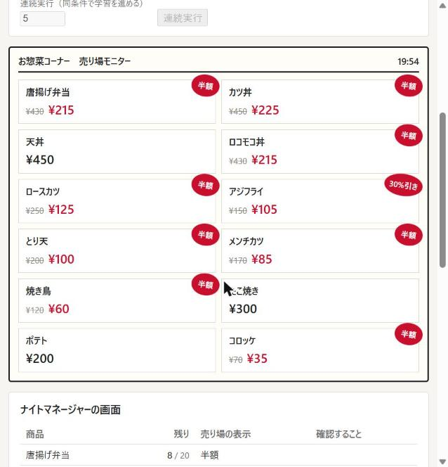
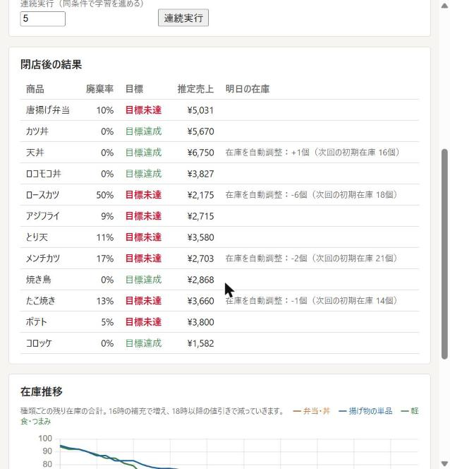

# 惣菜の値引きシステム（見切り品の動的値引きシミュレーター）

スーパーの惣菜売り場でのアルバイト経験から作ったポートフォリオ用アプリです。
惣菜の値引きは「19時＝30%引き・20時半＝半額・21時＝ズバリ引き」のように時刻で決まっていて、
雨の日は売れ残り（廃棄ロス）、晴れの日は早く売り切れ（機会損失）が起きていました。
「その日の売れ行きを見て、値引きのタイミングと幅を決められないか」という発想から作っています。

実店舗とは連携せず、乱数でお客さんの購入を作るシミュレーションとして動作を確認できるデモです。

## 作り直し（2026年11月）

最初の版は「ベイズ更新で値引き率を計算できること」を見せる技術デモで、画面にも処理の流れにも
**売り場で働く人（値引きを決めるナイトマネージャー、買うお客さん）が出てこない**ことが課題でした。
中心の逐次ベイズ更新はそのままに、まわりを実際の惣菜売り場の業務に合わせて作り直しました。

- **売り場の1日をそのまま再現**：昼（12時が一番の山）に定価で売る → 16時に補充 → 17時台の夕方の山も
  定価 → 18時以降に値引き。昼に値引きはしない
- **15分ごとに「上げる」か「そのまま」**：15分ごとに売れた数を集めて予測を更新し、今の値引きのまま
  閉店までに売り切れる見込みがなければ**+5%**、見込みがあればそのまま。値引きは20%から始まり、
  75%まで**5%刻み**。一度出した値引きは下げない（お客さんの信頼のため）
- **ナイトマネージャーの承認**：55%未満は自動で出すが、55%以上は取り返しがつかないので、
  ナイトマネージャーが承認してから出す（承認の遅れを条件として選べる）
- **16時の補充は売り場を満杯に**：夜の標準の量まで補充し、昼の売れ行きが悪ければ少なめ、
  よければ多めにする（0.7〜1.3倍。昼の売れ残りがあればその分だけ減らす）
- **シールの代わりに売り場モニター**：お客さんに見せる値札をモニターに出す
- **12商品・3種類**：弁当・丼／揚げ物の単品／軽食・つまみ。「半額で弁当はほぼ売れるが、単品は残る」
  という売り場での観察を、種類ごとの値引きの効きやすさの違いとして表す
- **長期休みの条件**：大学の休み・帰省の期間はふだんと客数が違う。前もって分かることなので人が入れ、
  その日の学習はふだんの日の予測に混ぜない

- **状況の変化への3つの対策**：
  - 前もって分かる変化（長期休み）は**人が条件として入れる**
  - 当日の変化は、昼過ぎに販売数が予測から大きく外れた商品が半分以上あれば「今日はいつもより売れていません。
    入れ忘れた条件がないか確認してください」と**店全体に知らせる**（いつもどおりの日の誤報7%、長期休みを
    入れ忘れた日の87%で気づける）
  - ゆっくりした変化（客層の変化など）は、**古いデータを少しずつ忘れる**（毎日、確信の強さを1割弱める）
- **作る量を予測から決める**こともできる：長期休みを正しく入れると作る量が減り、廃棄が約4分の1になる
  （シミュレーション用に「実は長期休み（店は入れ忘れ）」などの実際の状況を選べる）



営業中は、お客さんに見せる「売り場モニター」と、値引きの状況と承認待ちを確認する
「ナイトマネージャーの画面」を並べて表示します。



閉店後は商品ごとの廃棄率・推定売上と、翌日の作る量の自動調整を表で表示します。

## 予測のしくみ（逐次ベイズ更新）

- 商品ごとに、天気×曜日×イベント有無×長期休みの**24条件**それぞれの需要の予測を、
  ガンマ分布（事前分布）で持つ
- お客さんの購入（ポアソン分布）が起きるたびに、ガンマ-ポアソン共役で事後分布を更新する。
  **時間帯の売れやすさと値引きによる需要の伸びを「既知の露出」として扱う**ので、1日の売れ方や
  値引きを入れても共役のまま計算できる（`alpha += 売れた数`、`beta += 時間帯の重み × 値引きの需要倍率`）
- 営業の終わりの事後分布を、同じ条件の次の日の事前分布として引き継ぐ（学習の継続）
- **値引きの判断に予測を使う**：18時以降、15分ごとに「更新した予測で見て、今の値引きのまま閉店までに
  売り切れるか」を確かめ、無理なら+5%。以前は見込みだけで先回りして大きく値引きし、売り場の感覚に
  合わなかったため、18時以降に5%ずつしか上げないようにしている

### 作り直しの途中で見つけて直した問題

- **本当の需要が無かった**：お客さんの購入を「店側の予測」から作っていたため、予測がたまたま下がると
  翌日の客も減ってまた下がる…と、予測が0に向かって流れていた。商品ごとに「お客さんの本当の需要」を
  別に持ち、購入はそこから作るように直した。最初の予測をわざと半分にしても、学習を重ねると本当の需要に
  戻ることをテストで確認している
- **売り切れたときの学習の偏り**：棚の在庫が足りず欲しい数だけ売れなかったときに、売れた数（在庫で
  頭打ち）をそのまま需要として学び、需要を小さく見積もっていた。「売り切れるまでの間だけ売っていた」
  とみなして学ぶように直した
- **値引き幅の逆算の式**：値引きの効き方の式を変えたときに、逆算する側だけ古い式のまま残っていた

## 固定時刻の値引きとの比較（正直な結果）

同じお客さんの来店パターン（同じ乱数）で、時刻で決める値引き（19時30%・20時半半額・21時75%）と比べた
結果です（12商品・30通りの乱数の平均）。原価は売値の6割と仮定しています（業界団体の調査の惣菜の
利益率37.8%から換算した仮の値）。

| 条件 | 動的値引き（売上・利益） | 固定時刻（売上・利益） |
|---|---|---|
| 晴れ・平日 | ¥56,291・¥19,867 | ¥56,033・¥19,610 |
| 雨・平日 | ¥39,893・¥10,169 | ¥40,129・¥10,404 |

- 晴れの日は、値引きしなくても売れる商品（12商品×30日の45%）を値引きなしで売り切り、動的値引きの方が
  売上も利益も多い。雨の日はわずかに届かない
- 売り場では、値引きの時刻が毎日同じだとお客さんが覚えて待つ（18時台は買い控え、30%引きの間も
  半額を待つ）様子が見られた。この効果を仮定として入れると、動的値引きの方が廃棄も売上も良くなる。
  ただしこれは観察にもとづく**仮定**で、画面でも切り替えられるようにしている
- 値引きの判断には原価は関係ない（18時の時点で原価はもう払っているので、捨てるより少しでも高く売れれば得）

### 気づいた次の課題：作る量

利益で比べると、作る量を「定価で売れる見込みの量」にするのは**少なすぎる**と分かった。値引きすれば売れる分が
あるので、もう1個作ったときの得（定価なら+172円、30%引きでも+43円。唐揚げ弁当の場合）が、損（半額なら−43円、
捨てれば−258円）を上回るうちは、作った方が得になる。唐揚げ弁当で作る量を変えて200日分シミュレーションすると、
利益の平均は20個（いつもの量）で2,722円、28個で2,878円と山の形になった。作る量を変えて明日を何度も
シミュレーションし、利益が一番高い量を選ぶ仕組みが次の課題（調べたところ「新聞売り子問題」と同じ形）

## 主な機能

| 画面 | 内容 |
|---|---|
| 売り場 | 条件（天気・曜日・イベント・長期休み・目標廃棄率・承認の遅れ）を選んで1日を営業。売り場モニターとナイトマネージャーの画面、閉店後の結果、種類ごとの在庫推移。「予測のしくみを見る」で商品ごとの事後分布（確信度が上がる様子）を表示。連続実行で学習の様子を見られる |
| 商品 | 商品の追加・編集・削除。基準需要1つから24条件の予測を自動計算。作る量の自動調整の履歴 |
| 履歴 | 過去の営業の一覧、条件での絞り込み、CSVダウンロード、値引き率の推移 |
| 振り返り | 固定時刻との比較／値引きの時間帯（条件ごとの初回値引き時刻）／早く売り切れた商品／売れ残った商品 |

## 技術スタック

| 層 | 技術 |
|---|---|
| Backend | Python 3.11 + FastAPI |
| 統計計算 | ガンマ-ポアソン共役によるベイズ更新（標準ライブラリ `random` のみ。外部統計ライブラリ不使用） |
| ORM / DB | SQLModel + SQLite |
| Frontend | React 19 + Vite + TypeScript |
| グラフ | Chart.js（`react-chartjs-2`） |
| テスト | バックエンド pytest ／ フロントエンド Vitest + Testing Library |

## セットアップ

```bash
# バックエンド
cd backend
pip install fastapi uvicorn sqlmodel pytest httpx
python -m seed.load                     # seed JSON を SQLite に投入（DBの形が変わったら app.db を消してから）
uvicorn main:app --reload --port 8002   # http://localhost:8002/docs（フロントのプロキシ先に合わせる）
pytest                                  # バックエンドのテスト

# フロントエンド（別ターミナル）
cd frontend
npm install
npm run dev                             # http://localhost:5174
npx vitest run                          # フロントエンドのテスト
```

## テストについて

- バックエンド：ベイズ更新・値引きの判断・承認の遅れ・補充・本当の需要への収束などのロジックを
  pytest で検証
- フロントエンド：値札の値段の計算や在庫推移の集計などは React のレンダリングを介さない純関数として
  切り出し、Vitest で直接テスト
- jsdom（テスト用の仮想ブラウザ）には canvas の実装が無く、Chart.js のグラフが連続更新時にテスト環境
  特有のエラーを起こす。グラフ描画はスタブに差し替え、その裏側のデータ整形ロジックを別にテストしている

## 今回のスコープ外

- 実店舗のPOSレジ・在庫システムとの連携、実際の天気APIとの連携
- ナイトマネージャーが画面で実際に承認ボタンを押す対話型の営業（今は承認の遅れを条件として再現）
- 複数店舗・ユーザー認証・デプロイ

詳細な仕様は [`docs/spec.md`](docs/spec.md) を参照してください。
